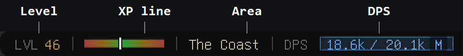
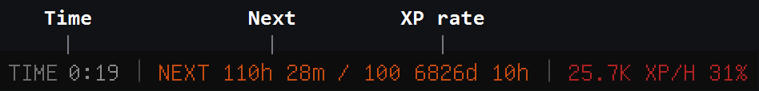
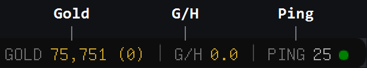
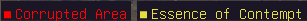
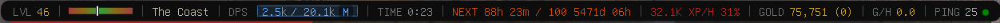
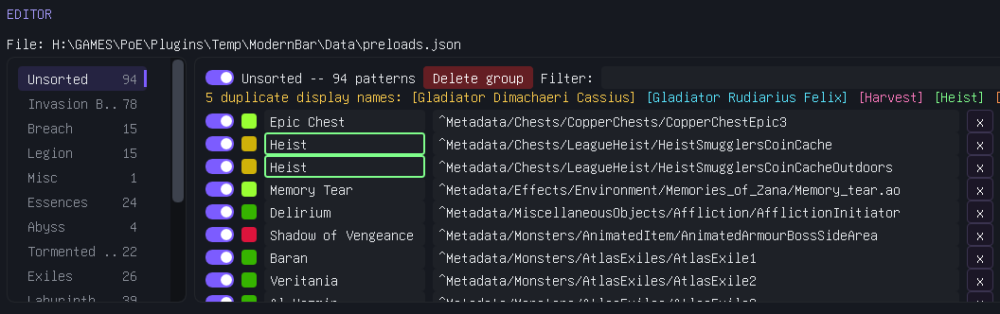

# ModernBar

A segmented info bar for ExileAPI. No pipes.

> **Note:** ModernBar replaces the default MiscInformation bar. Turn off
> MiscInformation in the HUD settings (F12) to avoid doubled info.

## Features

| Level, area, DPS | Time and XP rate |
| --- | --- |
|  |  |
| **Gold and ping** | **Preload colors** |
|  |  |

Quiet moments show DPS near zero. With no damage recorded it shows zeros:

Preload tracking uses per-pattern colors with a regex tester, and every
segment has editable themes. The Preloads tab edits the pattern file:
groups with counts, per-pattern toggles and colors, duplicate
display-name warnings.

## Settings

The Info Bar tab controls which segments appear and where the bar sits. Preloads manages the pattern file and
shows duplicate display names in matching colors. Themes holds the palette
and alpha values.

## Installation

1. Copy `ModernBar/` into `Plugins/Source/`.
2. Start the HUD. It compiles source plugins at startup.
3. Enable the plugin in the HUD menu.

## Version

v1.0. See `CHANGELOG.md`.
